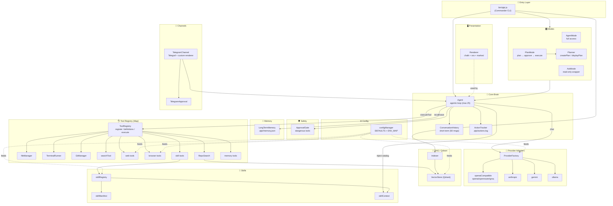
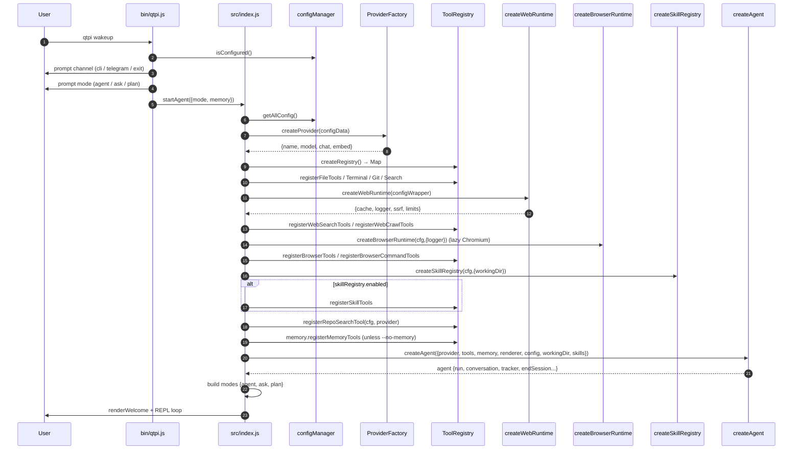
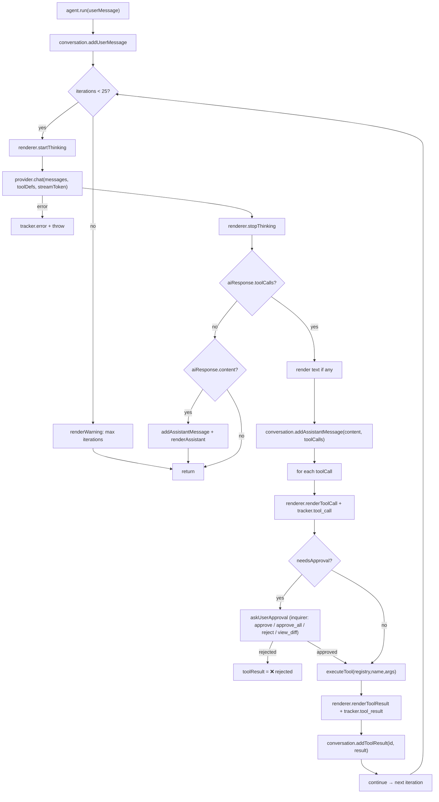
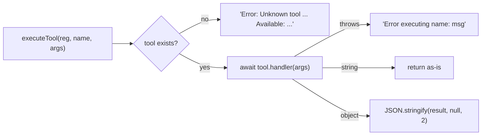
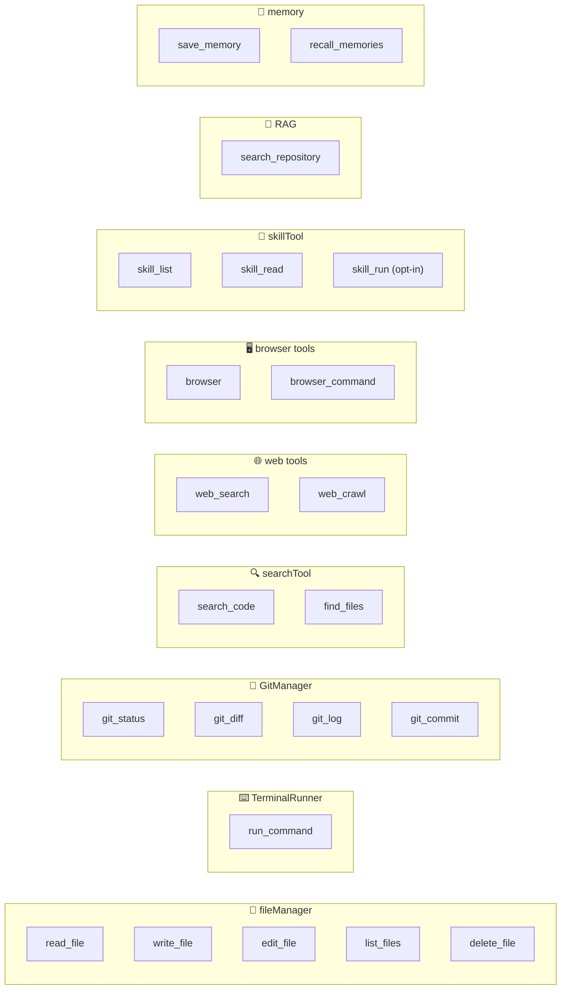
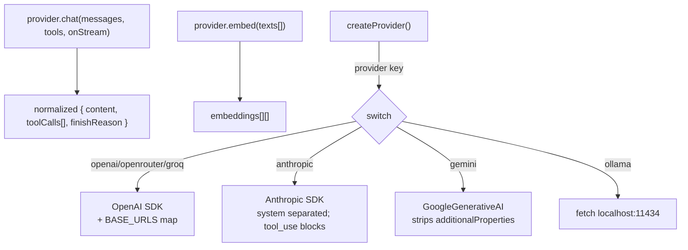
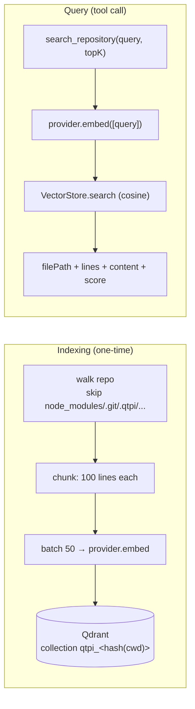
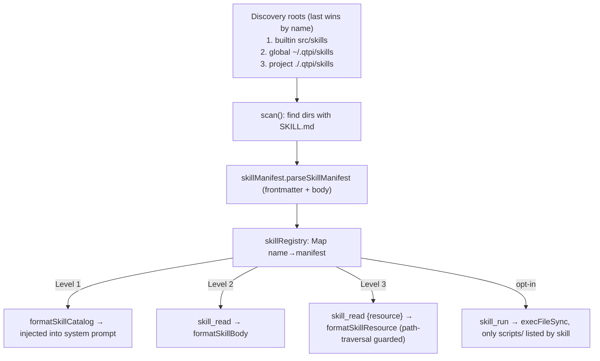
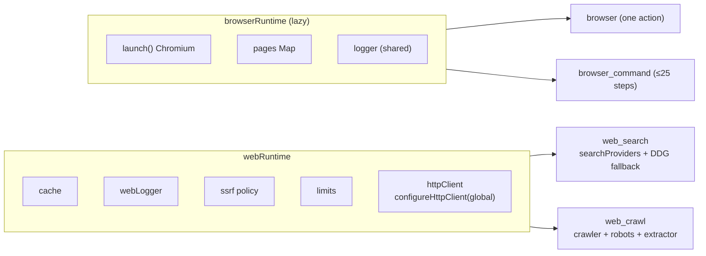
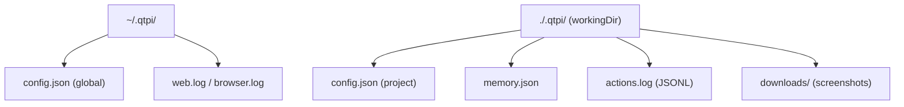

# 🏗️ QTPi Architecture

A complete map of how QTPi-Remastered is put together: the layers, the agentic
loop, the tool registry, the provider adapters, RAG, skills, and the web/browser
runtimes. Every diagram below is drawn from the actual source.

> **Want an editable diagram?** Use the `excalidraw` skill
> (`skill_read { name: "excalidraw" }`) to turn any of these flows into an
> `.excalidraw` scene you can open at <https://excalidraw.com>.
>
> 📐 A ready-made editable scene of this architecture lives at
> [`docs/diagrams/qtpi-architecture.excalidraw`](diagrams/qtpi-architecture.excalidraw)
> — open it at <https://excalidraw.com> (File → Open) or with the VS Code
> Excalidraw extension.

---

## 1. High-level layered architecture



---

## 2. Startup / wiring flow (`startAgent`)



> **Note:** `createWebRuntime(config)` has a side effect — it calls
> `configureHttpClient({ ssrf, logger })`, installing the SSRF policy globally on
> the shared HTTP layer.

---

## 3. The agentic loop



### Tool execution contract (`ToolRegistry.executeTool`)



---

## 4. Tool catalog



**Dangerous tools (gated by `ApprovalGate`):** `write_file`, `edit_file`,
`delete_file`, `run_command`, `git_commit`.

---

## 5. Provider adapter layer



| Provider | `chat` | `embed` |
|---|---|---|
| openai | ✅ (streaming + tool_calls glue) | ✅ `text-embedding-3-small` |
| openrouter / groq | ✅ | ❌ throws (use OpenAI/Gemini/Ollama) |
| anthropic | ✅ (`tool_use` / `tool_result`) | ❌ throws |
| gemini | ✅ (`functionCall`, role="model") | ✅ `text-embedding-004` |
| ollama | ✅ (non-streaming) | ✅ `/api/embeddings` |

---

## 6. RAG pipeline (`qtpi index` → `search_repository`)



`VectorStore` guards with `isIndexed()` (checks the collection exists **and**
`points_count > 0`) before searching.

---

## 7. Skills system (3-level progressive disclosure)



---

## 8. Web & browser runtimes (shared services)



---

## 9. Persistence map



Config resolution priority: **env var → project config → global config →
built-in `DEFAULTS`** (`configManager.getConfig`).

---

## 10. Module dependency tree

```
bin/qtpi.js
├── src/index.js ────────────────► startAgent()
│   ├── config/configManager.js
│   ├── providers/ProviderFactory.js
│   ├── tools/ToolRegistry.js
│   ├── tools/{fileManager,TerminalRunner,GitManager,searchTool}.js
│   ├── tools/{webSearchTool,webCrawlTool}.js ─► tools/web/webRuntime.js
│   ├── tools/{browserTool,browserCommandTool}.js ─► tools/browser/{browserRuntime,browserActions}.js
│   ├── skills/skillRegistry.js + tools/skillTool.js
│   ├── rag/{RepoSearch,VectorStore,Indexer}.js
│   ├── memory/LongTermMemory.js
│   ├── core/Agent.js
│   │   ├── memory/ConversationHistory.js
│   │   ├── core/ActionTracker.js
│   │   ├── tools/ToolRegistry.js
│   │   ├── tools/ApprovalGate.js
│   │   └── skills/skillContext.js
│   ├── modes/{AgentMode,AskMode,PlanMode}.js ─► core/Planner.js
│   └── ui/Renderer.js
├── src/channels/TelegramChannel.js ─► core/Agent.js, TelegramApproval.js
├── src/rag/{VectorStore,Indexer}.js
└── src/providers/ProviderFactory.js
```

---

## ⚠️ Known issues / drift

1. **Case-sensitive import bugs (Windows-only tolerance):**
   - `bin/qtpi.js` imports `'../src/config/ConfigManager.js'` but the file is
     `configManager.js`.
   - `src/channels/TelegramChannel.js` imports `'./SearchTool.js'` but the file is
     `searchTool.js`.
   Both break on Linux/macOS.
2. **`createProvider` ignores its argument.** `ProviderFactory.createProvider()`
   takes **no parameters** and calls `getConfig()` internally, yet callers pass
   `configData` / `getAllConfig()`. Harmless but misleading.
3. **Telegram channel is stale.** `TelegramChannel.js` only wires
   file/terminal/git/search/rag tools — it does **not** register web, browser, or
   skill tools, and builds the agent without the `skills` param, so Telegram
   sessions diverge from the CLI feature set.
4. **`searchTool.js` `regex.test()` on a `/g` regex** with a manual
   `lastIndex = 0` reset — works, but fragile; `matchAll` per line would be safer.
5. **`search_repository` gates on `isIndexed()` first**, so it silently no-ops
   until `qtpi index` runs (by design, but the model may not know why).
